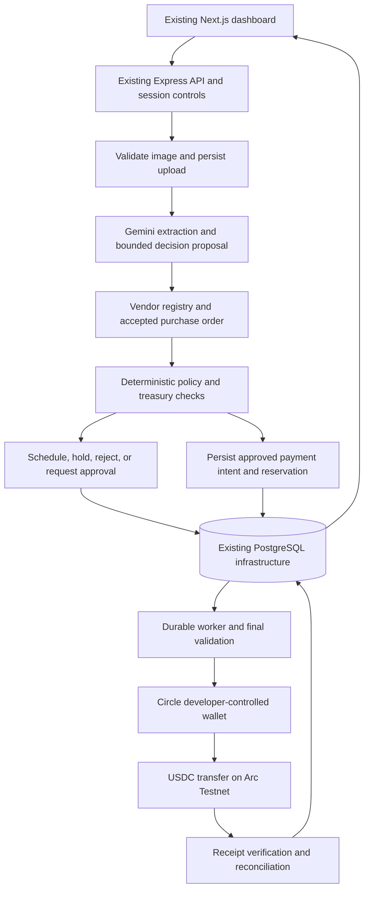

# AgentPay Treasury — three-day implementation plan

**Status: implementation authorized 8 October 2026. Specification prepared 6 October 2026; build and verification are in progress. Unverified capabilities below remain acceptance requirements, not delivered features.**

Working product name: **AgentPay Treasury**. Build a small business accounts-payable agent that understands an invoice, verifies the obligation and vendor, evaluates cash and budget constraints, chooses whether and when to pay, transfers USDC on Arc Testnet, and records the evidence behind that decision.

This is the build specification, not a claim that these capabilities already exist. The original source baseline is `/home/bryan/Downloads/AgentPay-main.zip`; the current Windows checkout already contains an import at commit `04d77d3`. The ZIP is unavailable on this host, so its recorded hash has not been reverified. `AGENTS.MD` defines implementation rules; `HISTORY.MD` records inspection, decisions, and subsequent evidence. The user explicitly authorized implementation and dependency installation on 8 October 2026.

**Current implementation checkpoint (13 October):** Offline payment implementation and validation are complete for the reduced MVP below: exact reservation/dispatch authorization, durable immutable transfer terms and fees, restart recovery, independently matched settlement/failure receipts, operator approvals/pause, worker heartbeats and evidence export. Verification: 230 regular tests, 35 PostgreSQL tests, 4 synthetic browser tests, lint/typechecks and production builds. The installed Circle SDK was exercised against a local HTTP server with generated synthetic credentials. Live Gemini extraction and Circle/Arc acceptance remain unverified and were explicitly deferred by the user. New live dispatch defaults off; no live transfer was made. Optional Q&A, discount selection and policy-editing UI remain excluded under the cut order. Use Node 22; see HISTORY.MD for evidence and limits.

## 1. Hackathon facts and product positioning

The [Tameion event page](https://tameion.thecanteenapp.com/) was checked on 6 October 2026:

- Event: 27 September–17 October 2026; submission closes 17 October, 11:59 PM ET, equivalent to 18 October, 09:29 AM IST.
- Arc USDC payments and Circle Agent Stack integration matter; testnet is acceptable. Genuine business usage matters; synthetic fixtures are not traction.
- Existing projects are eligible; disclose the starting point and demonstrate new product work and users acquired during the event.
- The five RFBs are prompts, not mandatory tracks. This proposal primarily addresses AP/AR Automation, with treasury and autonomous-operator elements.
- Suggested judging weights: agentic sophistication 30%, traction 30%, Circle tool usage 20%, innovation 20%.
- Delivery requires a public repository and a video under three minutes. A working deployment is encouraged.

The **three-day build deadline is this project's constraint**, separate from the event deadline. Start its 72-hour clock when implementation is authorized. The plan budgets about 30 focused person-hours, including contingency, across those three days.

**Product thesis:** an invoice extractor becomes useful to a business when it can distinguish a valid payable from a plausible-looking document, preserve enough cash for other commitments, and provide a traceable settlement. The strongest demo includes a justified decision to wait or refuse as well as a successful payment.

## 2. What the archive actually contains

The archive has 367 files, including static media, 17 `*.test.ts` files, and three SQL migrations. Its ZIP comment is `f4366d82be0bf34e1d413d41daf86bdfa5c88632`; this is an archive identifier, not independently verified Git ancestry. Its SHA-256 is recorded in `HISTORY.MD`.

| Area | Observed baseline | Consequence for this build |
|---|---|---|
| Workspace | npm workspaces: `apps/server`, `apps/web`, `packages/core`; TypeScript | Preserve the monorepo and package names initially. |
| Runtime | Node `22.23.2` in `.node-version` / `.nvmrc`; engines `>=22 <23`; npm `10.9.8` | Start with the lockfile and compatible Node 22; do not combine the pivot with framework upgrades. |
| Web | Next.js `16.3.4`, React `19.3.0`; landing page, styled `/dashboard`, wallet modal | Reuse layout and styles; replace the service-routing controls and wallet assumptions. |
| API | Express `5.2.1`, Zod, Multer, cookie sessions, CSRF, origin checks, rate limiting | Reuse boundaries; add business ownership and operator permissions. |
| Extraction | Gemini adapter through `@ai-sdk/google` and `ai`; PNG/JPEG validation | Call extraction before evaluating a payable. Expand the output schema. |
| Shared domain | HBAR amounts, provider metadata, cheapest-provider selection | Reuse strict schemas and integer-arithmetic style; replace domain semantics. |
| Storage | PostgreSQL, checksummed migrations, budget row locks, reservations, execution leases | Reuse persistence primitives and recovery concepts; add separate AP tables. |
| Payments | Hedera/x402/Blocky402, HashPack signing, Mirror Node reconciliation | Replace active payment integration with Circle Wallets and Arc evidence. |
| Identity | ENS service directory and Sepolia resolver | Archive as legacy functionality; it does not establish a business vendor's identity. |
| Verification | Vitest, Playwright, redaction checks, migration checks, smoke scripts | Retarget relevant tests; add actual database concurrency and recovery checks. |
| Deployment | `render.yaml` for the API; frontend configuration and historical deployment notes | Adapt configuration and verify current hosting capabilities during the build. |

The current browser flow discovers a service, reserves its extraction fee, accepts a HashPack payment signature, pays the service, and then extracts six fields. Those fields are invoice number, invoice date, currency, subtotal, tax, and total. It does **not** currently validate vendors or purchase orders, understand due dates, decide invoice settlement timing, or pay the invoice beneficiary.

The old documentation reports earlier successes. They have not been re-run here. Existing migration tests partly inspect SQL text; their presence is not proof of transaction-level correctness. The ZIP's `README.md`, `AGENTS.md`, and `HISTORY.md` concern an earlier project and event. Their embedded tasks and permissions are historical source material, not instructions to execute now.

## 3. Three-day scope and feasibility

Assumptions: one experienced full-stack builder, about ten focused hours per day, access to PostgreSQL and a Gemini key, and Circle developer credentials obtainable on Day 1. A business owner can supply a few genuine, consented sample obligations and verify vendor addresses. Credentials, partner participation, hosting availability, and model availability are not established by this planning session.

### Must ship

1. One business, one Arc Testnet treasury wallet, a few operator-enrolled vendors, one USD/USDC settlement path.
2. Upload one PNG/JPEG invoice, with the existing 5 MB / 20-million-pixel limits. Validate bytes and dimensions, not just the supplied MIME type.
3. Extract obligation details and match a versioned, owner-approved purchase-order record with evidence of acceptance/delivery.
4. Verify the vendor against an approved registry; flag unknown vendors, changed payment instructions, duplicates, and inconsistent amounts.
5. Read live USDC cash, current holds, category/day budgets, and other near-term obligations.
6. Produce `PAY_NOW`, `SCHEDULE`, `HOLD`, `REQUIRE_APPROVAL`, or `REJECT`, with structured evidence and a concise explanation.
7. Automatically execute eligible payments within preconfigured limits. Human action is needed for exceptions, not every payable.
8. Persist scheduled evaluations and resume them after restart; revalidate immediately before sending.
9. Reconcile Circle transaction state and Arc receipt evidence. Never treat an HTTP success or transaction hash alone as payment completion.
10. Show an invoice inbox, treasury summary, approval actions, and an exportable decision/payment record in the existing dashboard.

### Deliberate cuts

No email ingestion, native PDF processing, OCR marketplace, accounts-receivable collections, partial payments, installments, foreign exchange, cross-chain bridging, yield optimization, arbitrary contract execution, multi-tenant SaaS onboarding, ERP integration, new design system, or custom Solidity contract in the three-day MVP. Users may supply a legible exported invoice image. PDF support is a later upload-adapter extension, not a hidden Day 3 dependency.

Vendor validation means **registry, address, and obligation checks**. It is not legal-identity certification or comprehensive AML/KYC. Optional screening is specified below with an explicit access gate.

### Completion gate

Done means a real invoice image produces a stored obligation; a verified payable under policy executes one real testnet transfer through Circle; an unsafe/duplicate case sends nothing; a future payable survives a worker restart; an ambiguous submission cannot trigger a second payment; and a reviewer can see why each outcome occurred. A clearly labeled fixture demo is useful for testing but does not substitute for the live path or business-usage evidence.

## 4. Architecture and the reuse strategy



Reuse infrastructure and proven patterns, not the old ordering of business operations. Keep `apps/server/src/browser/flow.ts` as a thin browser-facing coordinator after refactoring; move financial logic into focused modules. Do not build a second application or replace PostgreSQL with a new datastore.

| Existing file or group | Planned change |
|---|---|
| `packages/core/src/amounts.ts` | Add micro-USDC decimal-string conversion and integer arithmetic. Keep legacy tinybar helpers only while old tests/imports need them; never relabel tinybars. |
| `packages/core/src/schemas.ts`, `index.ts` | Export obligation, vendor, PO, policy, decision, approval, and Arc-payment schemas/types. Keep legacy types isolated until their callers are retired. |
| `packages/core/src/policy.ts` | Replace active cheapest-service selection with pure decision eligibility and budget/timing functions, or move old selection into a legacy file. |
| `apps/server/src/extraction/gemini.ts` | Reuse image-to-structured-output adapter; extend fields and source evidence. Keep Q&A optional/read-only. |
| `apps/server/src/extraction/image.ts` | Reuse existing upload safeguards. |
| `apps/server/src/browser/flow.ts` | Coordinate invoice ingestion/status and call AP services. Remove wallet signatures, 402 quote acquisition, and pre-extraction payment from the active route. |
| `apps/server/src/app.ts` | Retain session/error/origin/CSRF patterns; register AP endpoints, role checks, and readiness. Unmount old provider/payment endpoints. |
| `apps/server/src/persistence/database.ts` | Retain pool/transaction patterns. Add AP reservation helpers using treasury/category locks and micro-USDC columns. |
| `apps/server/src/payments/client.ts`, `reconciliation.ts` | Replace active Hedera client and receipt parser with Circle adapter and Arc reconciliation; shared outcomes may be retained. |
| `apps/server/src/payments/server.ts`, `facilitator.ts` | Retire from active imports/routes; vendor payments are not an HTTP 402 fee. |
| `apps/server/src/recovery/paid-extraction.ts` | Preserve as legacy if needed. Reuse recovery principles in a new payment-intent recovery module, not its Hedera-specific preconditions. |
| `apps/server/src/ens/*`, `routing/prepayment.ts`, `readiness/provider.ts` | Remove from active boot dependencies; replace with vendor verification and treasury readiness. |
| `apps/server/src/auth/session.ts` | Extend signed claims with business, actor, and role; session ID is not a business identifier. |
| `apps/server/src/config.ts`, `.env.example` | Validate Arc/Circle/AP configuration. Remove the requirement for unused ENS/Hedera credentials. |
| `apps/web/lib/agentpay.ts` | Reuse credentialed fetch and CSRF handling; replace `RoutePreview`/`RunView` and request methods with AP contracts. |
| `apps/web/app/dashboard/{page.tsx,layout.tsx,dashboard.css}` | Keep shell, cards, tables and styling; show invoices, treasury, decisions, approvals, and settlement. |
| `apps/web/lib/hashpack-wallet.ts`, `hedera-wallet-payment.ts`, `wallet-store.ts` | Disconnect from active pages. Treasury identity comes from backend configuration; no frontend signing is required. |
| `apps/web/components/{Navbar,Hero,Architecture,ProblemSolution,Footer}.tsx` | Retain visual components; replace HBAR/ENS/router claims, wallet gate, and historical repository links. |
| `migrations/001_initial.sql`–`003_invoice_qa.sql` | Preserve exactly; their checksums and HBAR history must not change. Add `004_payables.sql`. |
| `scripts/db-migrate.ts`, `shared.ts` | Reuse migration runner and root-env loading. |
| `scripts/doctor.ts`, `smoke-testnet.ts` | Replace active readiness/smoke steps with Circle/Arc checks; make value-moving smoke execution explicitly distinguishable from read-only diagnostics. |
| `render.yaml`, `package.json`, tests | Adapt commands/env, add worker entry point, pin only necessary dependencies, and retarget tests. |

Proposed new modules, to be created only during implementation:

```text
packages/core/src/obligations.ts              # schemas, normalization, source evidence
packages/core/src/treasury.ts                 # monetary math and policy evaluation
apps/server/src/obligations/service.ts        # extraction, PO match, duplicate checks
apps/server/src/vendors/service.ts           # registry and versioned address validation
apps/server/src/treasury/service.ts           # balance and commitments snapshot
apps/server/src/agent/planner.ts              # bounded proposal from verified context
apps/server/src/payments/circle.ts            # narrow Circle adapter
apps/server/src/payments/arc.ts               # read-only chain verification
apps/server/src/payments/worker.ts            # claims, dispatch, scheduling, reconciliation
apps/server/src/audit/service.ts              # decision/event records and redacted export
migrations/004_payables.sql
scripts/seed-payables.ts                     # local/test seeds; no automatic transfers
```

Keep small helpers together where sensible. These boundaries describe responsibilities, not a mandate to manufacture many abstraction layers.

Do not maintain two runnable payment products in this sprint. If an old module still compiles against Hedera-specific `RuntimeConfig` fields, either retain a separate legacy type temporarily or retire that module and its obsolete tests after porting the useful behavior. Removing environment fields while leaving dependent source in the TypeScript build is not a completed migration. Document intentional legacy-code removals and preserve their provenance in the baseline.

## 5. Circle and Arc integration choices

**Primary choice: Circle developer-controlled EOA wallet on Arc Testnet**, operated through the Node SDK `@circle-fin/developer-controlled-wallets`. The official [wallet quickstart](https://developers.circle.com/wallets/dev-controlled/create-your-first-wallet) documents `ARC-TESTNET`, an API key, a registered entity secret, and the Node client. This fits the existing server and avoids requiring the user to approve each invoice in a browser wallet.

Use the [Circle Agent Stack](https://developers.circle.com/agent-stack) as the integration reference and record which Circle products actually run in the delivered workflow. Circle CLI can assist setup/diagnostics; install it only in the later implementation phase. Do not claim use of Gateway, Paymaster, or x402 merely because they appear in the stack's catalog.

The dedicated [Agent Wallets product](https://developers.circle.com/agent-stack/agent-wallets) offers CLI operation and spending policies, but it is a different integration from developer-controlled Wallets. Do not conflate their custody, authentication, sponsorship, or screening guarantees. Keep it as a post-MVP alternative rather than implementing two payment backends during the sprint.

### Network and units

| Setting | Planned testnet value |
|---|---|
| Chain ID | `5042002` |
| Circle blockchain | `ARC-TESTNET` |
| RPC | `https://rpc.testnet.arc.io` |
| Explorer | `https://explorer.testnet.arc.io` |
| USDC ERC-20 interface | `0x3600000000000000000000000000000000000000` |
| Business monetary unit | Micro-USDC, six decimal places, integer strings |

Network values come from [Connect to Arc](https://docs.arc.network/arc/references/connect-to-arc). The [contract reference](https://docs.arc.network/arc/references/contract-addresses) documents one underlying USDC balance with a six-decimal ERC-20 interface and an eighteen-decimal native interface. Read business cash through `balanceOf`; check `decimals() === 6`. Do not add the two balance views together. Convert native gas estimates upward into micro-USDC before reserving a fee buffer.

At runtime verify `eth_chainId`, configured wallet identity/network, and token identity before enabling execution. Do not substitute a different network if the RPC fails. If using the event's separate node service, verify it is the same intended chain and has compatible Circle support before changing configuration.

### Transfer contract

The adapter accepts only a persisted, policy-authorized intent: wallet ID, approved recipient, token/chain, exact decimal amount, and a stable UUID idempotency key. It does not accept arbitrary transaction calldata, wallet IDs, or destinations supplied by the model/browser.

The [transfer API](https://developers.circle.com/api-reference/wallets/developer-controlled-wallets/create-developer-transaction-transfer) exposes `idempotencyKey`, `destinationAddress`, amount strings, and wallet/token identification. Its REST field is `amounts`; the SDK uses its own typed input shape. Verify the installed SDK can take an explicit persistent key; do not let automatic key generation create a fresh attempt on every retry. Use the documented REST path behind the adapter if necessary, with supported entity-secret encryption, rather than inventing request fields.

Follow the [send-tokens workflow](https://developers.circle.com/wallets/dev-controlled/transfer-tokens-across-wallets) for submission/status reads, and the [state reference](https://developers.circle.com/api-reference/wallets/transaction-states-and-errors) for lifecycle mapping. Store Circle transaction ID separately from the Arc transaction hash. `INITIATED`, `QUEUED`, `CLEARED`, `SENT`, or `CONFIRMED` are not sufficient for the UI's final `SETTLED` state. Require `COMPLETE` and verified matching chain evidence. A timeout remains unresolved.

### Enforcement boundary

The model cannot change policy or access signing credentials. Deterministic backend code and database locks enforce caps; the Circle adapter handles custody/signing. **The MVP has application-enforced budgets, not on-chain budget enforcement.** A compromised privileged backend remains a risk. Use a dedicated, minimally funded testnet wallet and disclose this limitation. A separate policy contract or independently restricted signer is future work, especially before any production-funds deployment.

### Screening access gate

Baseline vendor checks are an owner-approved address registry, local denylist, version binding, PO matching, and duplicate detection. [Circle Compliance Engine](https://developers.circle.com/wallets/compliance-engine) requires eligible-customer access even on testnet; do not put approval for that service on the critical path.

If access already exists on Day 1, add a screening adapter and store provider, result, timestamp, and address/network checked. A blocked result rejects; an unknown, expired, or failed result holds. Once external screening is required by policy, outages must not silently switch to local checks. Without access, use the explicit `local_registry` demo mode and label it accurately. Never display “sanctions cleared” based on an allowlist alone.

## 6. Obligation and vendor rules

### Extraction and evidence

Extend the existing six-field schema with vendor name, invoice number, issue/due dates, PO reference, service description/period, line items, payment terms, and any printed payment address. Store raw extracted values separately from normalized values. Each critical field includes a short visible source excerpt or image-region reference and an `EXTRACTED`, `MISSING`, or `AMBIGUOUS` status.

Use strict ISO date normalization and retain the original date text. Ambiguous dates, missing currency/total, conflicting totals, unsupported precision, or absent obligation evidence produce a hold. A model's self-reported confidence is supplementary; it does not authorize payment. Keep uploaded text and images explicitly untrusted, including text claiming to be an instruction from an administrator.

For MVP, support invoices denominated in USD or USDC only, with a vendor's explicit agreement to receive a matching USDC amount. This is a product settlement convention, not a general USD-to-token conversion mechanism. Non-USD currencies, credit notes, negative amounts, and overpayments require review; do not guess an exchange rate or silently clamp a total.

### Registry and approved purchase orders

Owner-maintained records contain a stable vendor ID, display/legal name and approved aliases, active/blocked status, verified Arc address, verification evidence/date, address version, permitted currency, category, and settlement agreement. Address changes are operator actions with a reason; they invalidate unsubmitted decisions/approvals. An address printed in an invoice never replaces the registry address automatically.

Seed a minimal PO record rather than building contract ingestion: business/vendor, PO ID, authorized amount, already-settled amount, service period/description, due/discount terms, delivery-accepted flag, acceptance reference, and version. The owner supplies this independent evidence before invoice upload. Matching checks vendor, PO, accepted service/delivery, outstanding amount, invoice arithmetic, and dates. Unknown vendors or missing acceptance evidence go to review. A matching invoice alone is not proof that the work was delivered.

Only one invoice per PO is supported initially; partial billing and multiple installments are deferred. Owners can correct extraction or supply missing evidence through a versioned review action. Such a correction appends history and triggers re-evaluation; it is not a direct “pay anyway” override.

Enforce that single-invoice PO rule with a business-scoped unique active obligation/PO relationship and transactionally validate PO availability. If verified discount terms settle the whole obligation for less than its nominal amount, record nominal amount, discount adjustment, and actual cash paid separately; close the accepted obligation without leaving the discount as a fictitious unpaid balance.

### Duplicate detection

- Exact-file duplicate: unique `(business_id, input_sha256)`; reuse the existing upload hash pattern across sessions.
- Business duplicate: unique normalized `(business_id, vendor_id, invoice_number)` once the vendor is resolved. Conflicting copies are held against the original, not made separately payable.
- Similarity signal: same vendor/amount/service period/PO with a different invoice number triggers review.
- Payment uniqueness: one active payment intent per obligation, one settled payment, unique provider idempotency keys and chain transaction hashes.

Do not rely solely on a session-scoped idempotency key or image hash. Two scans of the same invoice can have different bytes. Never include the amount in the primary invoice identity so that altering an amount cannot bypass duplicate detection.

## 7. Treasury, policy, and agent decisions

### Initial policy, expressed in USDC

These are small **proposed testnet demonstration values**, not recommendations for a real business:

| Rule | Default |
|---|---|
| Automatic payment maximum | `2.00` per invoice |
| Absolute application transfer ceiling | `5.00` per invoice, including operator-approved exceptions |
| Daily payout budget | `10.00`, UTC calendar day |
| Category monthly budget | `8.00` per category, UTC calendar month |
| Treasury minimum reserve | `5.00` |
| Protected upcoming obligations | Sum of other accepted, essential obligations due within seven days |
| Gas allowance | Conservative live estimate, rounded upward, plus configured buffer |
| Balance/decision freshness | At most 30 seconds at dispatch; otherwise refresh |
| External screening freshness, if enabled | At most 24 hours and immediately invalidated by address change |
| Worker evaluation cadence | Every 30 seconds while the service is running |

Represent financial values as `bigint` in TypeScript, integer decimal strings in JSON, and `NUMERIC(20,0)` with nonnegative checks in PostgreSQL. Never use floating-point arithmetic for payment amounts or money comparisons. One USDC equals `1000000` micro-USDC. The UI formats values for display without changing the stored amount.

### Available cash and reservations

For a timestamped chain snapshot, compute:

```text
spendable cash = confirmed USDC cash
               - unreflected active payment holds
               - minimum reserve
               - protected upcoming obligations not already represented by holds
               - estimated fees and fee buffer

category available = category limit - settled spend in period - active category holds
daily available    = daily limit - settled spend today - all active daily holds
```

Exclude the candidate invoice from the protected-obligations subtraction, then test its amount against the remaining cash. A held payment cannot also count as an unpaid future commitment. A payment already reflected in the snapshot must not be subtracted a second time. Record snapshot block/time and inclusion evidence; if this cannot be established, conservatively keep the hold and stop further dispatch until reconciliation.

Simplify the MVP to **one in-flight transfer per treasury wallet**. Reserve atomically under a stable treasury row lock; process additional invoices after its settlement/failure is reconciled. Holds survive midnight and restarts. Count settled spend by settlement timestamp; pending holds count regardless of their creation date. A due-date schedule is not a cash reservation or guaranteed future payment; dispatch rechecks the then-current period's budget.

### Decision order and human authority

| Condition | Result | May a normal approval override it? |
|---|---|---|
| Already settled / exact payable duplicate / blocked vendor | `REJECT` with linked evidence | No |
| Missing PO/acceptance, ambiguous amount/date, unknown or changed vendor address | `HOLD` | No; correct/verify evidence first |
| External screening required but stale/unavailable | `HOLD` | No |
| Insufficient cash/reserve, category/day budget exceeded, or hard transfer ceiling exceeded | `HOLD` | No; a separate owner policy/funding change and new evaluation is required |
| Otherwise valid, amount above automatic threshold but within hard ceiling | `REQUIRE_APPROVAL` | Yes, for that exact versioned intent only |
| Safe payable due now/overdue | Eligible for `PAY_NOW` | Already inside delegated authority |
| Safe payable due later, no justified benefit to paying early | `SCHEDULE` | No payment yet |
| Verified early-payment discount that improves the documented cash scenario | Eligible for `PAY_NOW` at agreed discounted amount | Still subject to every cap |

Human approval binds obligation version, registry version/address, policy version, amount, chain, token, and decision ID. It expires after 24 hours or any material change. Approval resolves only the soft per-invoice threshold; it does not bypass duplicate checks, hard budgets, liquidity, or screening. Rejection/cancellation before submission releases reservations; cancellation after submission must reconcile, not imply that an irreversible transfer was undone.

### What the AI actually decides

Implement one bounded planner call after extraction and deterministic validation. Supply the normalized obligation, accepted PO/terms, source evidence, vendor result, treasury snapshot, nearby commitments, policy constraints, and a server-generated list of allowable actions/dates/amounts. Its output is strict JSON: selected candidate ID, concise reason, cited evidence IDs, assumptions, and an alternative considered.

The agent can choose to preserve cash, take an eligible discount, schedule within the safe window, or escalate uncertainty. It cannot invent an amount, recipient, due date, policy, or transfer tool. Deterministic validation rejects an unavailable candidate or unsupported reason. Missing/invalid model output yields `HOLD`; do not silently claim an autonomous decision from a hard-coded fixture.

Keep the opportunity-cost comparison simple: compare documented discount savings with a configurable cash-preservation cost and reserve impact, using integer basis points and dates. Default the cash-preservation cost to zero and disclose that assumption. Only owner-verified discount terms can change the payable amount. Store the calculation and nominal/discounted amounts; do not invent a financing rate.

This is a bounded business-decision agent, not an unrestricted multi-agent system. Tests should show the same otherwise-valid invoice producing a different decision when cash commitments or verified terms change. Audit a concise decision explanation and facts; do not request or store hidden chain-of-thought.

## 8. Persistence and migration design

Add `004_payables.sql` using the existing checksum migration runner. Use `ap_` prefixes to avoid changing the meaning of existing `runs`, `requests`, `payments`, and `budget_reservations`. Keep old HBAR records as old HBAR records. A new development database is simplest, but test applying 004 both after a clean 001–003 sequence and over a populated legacy fixture.

All AP entities belong to a configured `business_id`; obtain it from authenticated claims/server configuration. Use foreign keys that preserve that ownership, UTC timestamps, and explicit version columns. In the single-business MVP this is a stable identifier, not a full organizations/membership feature.

| Proposed table | Required contents and constraints |
|---|---|
| `ap_treasuries` | Business/wallet identity, chain/token, enabled/paused flag, policy JSON and monotonically increasing policy version. One row locked for all financial state changes for this wallet. |
| `ap_vendors` | Business/vendor ID, normalized name/aliases, address, address version, approval/blocked state, category, verification evidence, settlement convention. Address lookup is chain-bound. |
| `ap_purchase_orders` | Vendor/business link, expected amount and outstanding amount, service/acceptance evidence, verified terms, version. No outstanding amount below zero. |
| `ap_obligations` | IDs, source hash, input idempotency key/fingerprint, extracted/normalized JSON, vendor/PO links, invoice-number key, amount/currency, dates, lifecycle status, version, `next_evaluation_at`, worker lease fields. Unique file and vendor/invoice identities. |
| `ap_inputs` | Obligation link, validated MIME, byte size, private image bytes, expiry. Adapt `run_inputs` storage pattern; do not expose blobs publicly. |
| `ap_decisions` | Immutable decision version, action, selected candidate, reason/evidence IDs, model/prompt version, policy/vendor/PO versions, treasury snapshot, evaluated/expiry timestamps. |
| `ap_approvals` | Decision/obligation version, exact authorized terms hash, approver actor, grant/deny, reason, expiry, consumed timestamp. Never reusable for another decision. |
| `ap_payment_intents` | Obligation/decision FK, exact recipient/amount/network/token snapshot, stable Circle key, immutable request fingerprint, provider ID/hash, state, lease fields, fee estimate/actual fee, submitted/settled timestamps, error classification. |
| `ap_reservations` | Intent link, payout/fee amounts, category, `HELD/CONSUMED/RELEASED`, time and budget period. One reservation per intent. |
| `ap_events` | Append-only events for ingestion, verification, decision, approval, dispatch, reconciliation, corrections and pauses; actor, entity/version, timestamp, redacted payload and event key. |

Necessary constraints/indexes:

- Unique upload request key within a business, with a stored full input fingerprint; changed input under the same key is `409`.
- Unique `(business_id, input_sha256)` and partial unique `(business_id, vendor_id, normalized_invoice_number)` when normalized identity is known. Record conflicting uploads as events or rejected responses pointing to the original.
- Partial unique index on an obligation's intent while state is `RESERVED`, `SUBMITTING`, `PENDING`, `UNKNOWN`, or `SETTLED`. This permits a new attempt only after conclusively failed/cancelled attempts and fresh evaluation.
- Unique Circle idempotency key; unique Circle transaction ID; unique `(chain_id, transaction_hash)` when non-null.
- Positive payout amount; nonnegative fee/reserve fields; `SETTLED` requires hash, provider ID, verified-receipt metadata and settlement timestamp.
- Index due evaluations and unresolved intent state/updated time. Use `FOR UPDATE SKIP LOCKED` with leases for work claims; leases alone do not authorize re-sending.
- Store amounts as database numerics returned as strings. Never coerce the `pg` numeric parser to JavaScript `Number`.

Decisions/events should reject application-role UPDATE/DELETE through database privileges or a tested trigger. Keep mutable lifecycle state in the obligation/intent tables. An append-only application log is not a tamper-proof public ledger; a database administrator can still alter it. Avoid claims of immutable accounting or full double-entry bookkeeping. The MVP records payable settlement and audit events; ERP-grade journals are deferred.

## 9. Lifecycle, scheduling, and safe recovery

Keep three independent concepts: obligation lifecycle (`RECEIVED`, `ANALYZING`, `OPEN`, `SETTLED`, `REJECTED`, `CANCELLED`); decision action (Section 7); and payment lifecycle below. A scheduled or held invoice is `OPEN` with its latest decision and next evaluation time. Do not confuse an extraction success with a payment success.

```text
RESERVED -> SUBMITTING -> PENDING -> SETTLED
                   |          |
                   +----------+-> UNKNOWN -> PENDING / SETTLED / FAILED
RESERVED -> CANCELLED
SUBMITTING / PENDING -> FAILED only with definitive evidence
```

1. **Ingest:** authenticate, validate upload, hash and persist once, return an obligation ID. Extraction is asynchronous and has its own lease/error state.
2. **Evaluate:** read stored input, extract, verify vendor/PO, build a current snapshot, validate planner output, persist the decision and event. Perform model/network calls outside long-lived SQL locks.
3. **Schedule/hold:** persist the next evaluation time and reason. A schedule targets the verified due date, normally 09:00 UTC that day; explicit owner-confirmed discount deadlines can produce an earlier candidate. Preserve date-only values separately. In tests inject a clock; never alter production due dates to manufacture evidence.
4. **Reserve:** for an allowed payable, lock treasury then obligation in a consistent order, recheck uniqueness, versions, approval and balances/budgets, create intent/key/reservation/event, commit. A scheduled payable gets a reservation only when dispatched.
5. **Dispatch:** claim the intent, reload approved terms and current policy/vendor status, require fresh cash/fee evidence, atomically mark `SUBMITTING` before the Circle call, then send exactly the stored terms. If material facts changed, cancel the unsubmitted intent, release its hold and re-evaluate.
6. **Observe:** persist Circle ID and later hash; poll with capped exponential backoff. After a short UI wait budget (e.g. 30 seconds), return the persistent pending state. The worker continues; the browser request does not need to stay open.
7. **Settle:** require provider completion and a successful Arc receipt whose verified transfer matches the configured token, sender wallet, recipient and amount. For the chosen ERC-20 transfer path, verify the transfer event/call using the actual Day 1 receipt shape. If the provider uses a different underlying transfer encoding, explicitly implement and test that verifier rather than treating a missing ERC-20 event as success.
8. **Commit:** in one database transaction mark settled, consume the reservation, update PO outstanding amount and obligation, consume any approval, and append a unique settlement event. If the process crashes after chain success, recovery performs this local commit without making a new payment.

### Crash and retry contract

| Failure point | Required behavior |
|---|---|
| Before reservation commit | No payment exists; safe to re-evaluate. |
| After reservation, before dispatch | Recover the stored intent; recheck freshness/versions. |
| After marking submitting, before/after Circle response | Reconcile using stored key/provider ID. Unknown does not mean failed. |
| Timeout with no provider ID | Recover via the same documented idempotent request/key within its verified validity window; do not generate another key. Persist equivalent semantic terms even if encryption ciphertext must be refreshed. |
| Provider key validity/replay semantics cannot be established | Hold as `UNKNOWN` for operator investigation. Do not assume unlimited idempotency retention. |
| Provider says pending or RPC temporarily fails | Retain reservation and block another in-flight transfer for the wallet. |
| Definitive failure/cancellation | Release payout hold; account for any actual gas spent; append failure evidence. New attempts require fresh evaluation and a distinct audited attempt. |
| Success on chain, database update failed | Reconcile and finish the local atomic update; never resend. |

A transaction hash identifies an attempt, not a successful transfer. Verify receipt status and terms. An unexpected token/address/amount causes `UNKNOWN` plus investigation, not `SETTLED`. Retain holds until the discrepancy is resolved.

Run one durable Node worker from the server package. Poll PostgreSQL every 30 seconds for due obligations, unsubmitted intents, and unresolved transfers. Claim bounded batches; release expired evaluation leases; prevent overlapping dispatch for one treasury. Startup performs recovery before sending new payments. A manual “re-evaluate” button may enqueue the same work, but scheduling must also work without a browser tab.

Paused autonomy stops **new submissions**, while receipt reconciliation continues. A pause cannot reverse an already-submitted transfer. Missing worker heartbeat makes readiness unhealthy and is visible in the dashboard.

## 10. API, access, and UI contract

All monetary fields in JSON are strings; expose both formatted USDC and canonical `amountMicroUsdc` where useful. Return the existing error shape (`code`, `message`, `requestId`, `retryable`). Validate both requests and external responses with shared schemas.

| Proposed endpoint | Contract |
|---|---|
| `GET /health` | Process liveness; no secrets. |
| `GET /ready` | DB/schema, configured chain/wallet, and worker heartbeat; report unavailable dependencies without leaking credentials. |
| Existing `/api/session` methods | Signed business/actor/role claims, expiry, CSRF; stable business access after reconnect. |
| `POST /api/invoices` | Multipart `invoice`, optional PO hint; `Idempotency-Key` required; `202` obligation/status link. Client cannot supply a payout address or authoritative amount. |
| `GET /api/invoices` | Paginated business-scoped inbox, derived decision/payment status. |
| `GET /api/invoices/:id` | Normalized fields, evidence, latest decision, version, payment references. Private image through a separate authenticated response. |
| `POST /api/invoices/:id/evaluate` | Enqueue re-evaluation; idempotent against current version. |
| `PATCH /api/invoices/:id` | Operator correction of extracted fields or evidence; expected version and reason required; invalidates unsubmitted decision/approval. |
| `POST /api/invoices/:id/approve` | Operator only; decision ID/version, expected obligation version, approved terms hash and reason. Creates an approval, not a raw transfer. |
| `POST /api/invoices/:id/reject` | Operator only; reason; permitted only before submission. |
| `POST /api/payments/:id/reconcile` | Operator only; reads provider/chain and updates local evidence; never creates a new transfer. |
| `GET /api/treasury` | Cash, holds, minimum reserve, obligations due, category/day headroom, snapshot time/block and pause state. |
| `GET /api/vendors` | Approved registry view. |
| `POST/PATCH /api/vendors` | Operator-only enrollment/change with version and verification evidence; no automatic invoice-driven updates. |
| `GET/POST /api/purchase-orders` | Operator creates verified PO/acceptance records; reads are business-scoped. Keep editing minimal and versioned. |
| `PUT /api/policy` | Operator-only policy update with expected version and reason; invalidates stale unsubmitted decisions. |
| `POST /api/treasury/pause` | Operator toggles new-submission pause with audit reason. |
| `GET /api/invoices/:id/audit` | Redacted JSON export of versions, evidence, decision, approval and receipt; no secrets/raw authentication material. |

Use `409` for idempotency/version/state conflict, `422` for invalid domain data, `401/403` for auth/role failures, and `503` for unavailable infrastructure. A legitimate hold is a successful evaluation result, not an HTTP 500.

### Authentication and reviewer access

Retain the existing demo-access mechanism for the prototype, but give operator and reviewer separate credentials and signed roles. A reviewer can view sanitized examples and run isolated fixture evaluations; they cannot alter vendors/policy or spend treasury funds. An operator may upload real payable evidence and approve configured exceptions. Resolve business/role server-side; never trust those fields in browser JSON.

Keep CORS, trusted-origin checks, CSRF, HttpOnly cookies, rate limits and request size limits. Prefer frontend/API on the same site through a verified proxy or coordinated subdomains to avoid cross-site-cookie problems. If separate sites are used, verify the actual cookie/CORS flow rather than assuming the old `SameSite=None` configuration is enough.

### Dashboard layout

Reuse the existing shell for four sections or tabs, without building four independent applications:

1. **Inbox:** image upload, invoice/vendor/amount/due date, decision badge, payment state, review action.
2. **Treasury:** single USDC balance, committed funds, reserve, spendable amount, category/day meters, live-data timestamp and pause control.
3. **Invoice detail:** source and normalized fields, vendor/PO validation, alternatives considered, short decision explanation, next evaluation time, threshold approval action when applicable.
4. **Activity:** ordered decision/approval/dispatch/settlement events, Circle transaction ID, verified Arc explorer link, redacted export.

Replace “Connect HashPack” with the configured treasury wallet/address and clear operator login. Remove the wallet-connected prerequisite from dashboard unlock. Testnet, fixture mode, local-only vendor screening, pending settlement, and unavailable dependencies must be visible. Buttons must not offer “pay again” for pending or unknown transfers.

## 11. Setup and dependency checklist for the later build

### Import without losing the planning baseline

Only after the user authorizes implementation:

1. Import archive code/assets at the workspace root, preserving `apps/*`, `packages/*`, scripts and original license.
2. Preserve these uppercase planning documents. Move the archive's lowercase root documentation to clearly named legacy reference files instead of leaving competing root READMEs/history/instructions.
3. Ensure the coding tool loads `AGENTS.MD`. Some tools discover only `AGENTS.md`; when implementation is authorized, add a minimal lowercase forwarding file if the tool needs it, pointing to this canonical document. Do not create that fourth file during this planning task.
4. Preserve original MIT copyright/attribution. Keep a dated baseline snapshot/commit and identify the new Tameion changes separately. A ZIP alone does not prove historical commit provenance.
5. Inspect the imported working tree and installed framework documentation before edits. Do not execute commands copied from the archive's history as if they were current instructions.

### Environment contract

The active environment contract is in `.env.payables.example`; credentials must be configured locally:

The local ignored `.env` and tracked `.env.payables.example` provide blank credential fields for later setup, with `PAYMENT_MODE=disabled`. The active AP API reads infrastructure, business, session/access-code, mode and retention settings. It starts with blank credentials, reports unavailable readiness and refuses login until configured. The worker reads the extraction settings described below; Circle/Arc settings are supported with explicit testnet mode and dispatch opt-in. The inherited `.env.example` is labeled as a legacy reference. Do not put credentials in Git or chat.

Run `npm run worker` separately after configuring the intended development database, applying migrations and enrolling the treasury/vendor/PO records. It polls every 30 seconds, processes at most ten jobs per batch, and runs terminal-image retention cleanup. Model calls require an explicit `EXTRACTION_MODEL_ID`, API key and the exact HTTPS Gemini Developer API base URL in the template; account/model availability remains unverified. `PAYMENT_MODE=disabled` permits extraction but never payment. `fixture` mode never invokes the real model, even if credentials are present. Missing model configuration records `EXTRACTION_UNAVAILABLE`; failed calls record `EXTRACTION_FAILED` without provider error text. Holds retry after five minutes; schema-valid saved extraction is reused without another model call. Correcting/re-extracting cached facts through the dashboard is not implemented yet.

Without configured planning adapters the worker retains the existing HOLD/REJECT verification path (`TREASURY_EVALUATION_UNAVAILABLE` for otherwise valid obligations). With `PAYMENT_MODE=arc_testnet`, matching enrolled treasury mode/wallet ID, explicit Arc RPC/chain/token settings, `SCREENING_MODE=local_registry`, `FEE_BUFFER_BPS` and `FEE_EXTRA_BUFFER_MICRO_USDC`, it reads cash and estimates fees for verified obligations before planning. Gemini planning uses the configured extraction model. Missing/failed models hold eligible payments; deterministic gates can still hold or require approval. Fixture mode never constructs a live planner or RPC reader. Synthetic adapters are injected only in tests.

The worker claims a fenced three-minute lease for extraction plus planning. External calls run outside database transactions. A single-statement, business-scoped ledger query includes all payment holds and settlements, owner POs and vendor/policy records; it preserves money as strings and refuses incomplete or oversized ledgers. Every accepted open PO is conservatively protected as essential because the current PO schema has no essential flag. Before committing, the worker locks treasury then obligation, verifies lease/version/duplicates, rereads and fingerprints financial state, and locally revalidates the already selected proposal and evidence freshness. Changed records produce HOLD. Candidate, model explanation/alternative, evidence, snapshot and next evaluation time are recorded atomically with the obligation and audit event. SCHEDULE uses the verified due time; other open outcomes retry after five minutes. Freshness expiry is bounded by the cash snapshot, not extended by the model call.

Planning creates no payment intent or reservation. Exact-version approval consumption is not connected, so amounts above the soft threshold still require approval. Stored receipt JSON is not accepted as fresh inclusion evidence: submitted, unresolved, settled or failed intents conservatively stop usable accounting until independent receipt/terminal-evidence verification is connected. `/ready` remains unavailable and worker liveness is not yet measured. Database lease/duplicate/restart tests must pass before this worker is considered verified for durable operation.

The `apps/server/src/payments/arc.ts` adapter reads only the configured wallet's six-decimal ERC-20 balance at a finalized Arc Testnet block. It checks chain identity, token decimals, block freshness and stable block hash, and never combines native and ERC-20 balances. Its cash timestamp is the block timestamp, with a separate observation time, so later model work cannot conceal stale chain evidence. It refuses fixture mode and never signs, submits or verifies a settlement. Wallet control, receipt shape and provider status are separate checks still to implement.

`apps/server/src/payments/arc-fees.ts` estimates gas for an EOA ERC-20 `transfer` of the exact registry recipient/obligation amount, pinned to the supplied cash block, using current EIP-1559 fee estimates. Explicit server-supplied buffers are applied with upward integer conversion from native units to micro-USDC. The reader copies and validates input, rechecks network/block/freshness after RPC calls, and returns bounded error codes. It never signs or submits. This is an RPC estimate for that specific transfer path, not a Circle quote or guaranteed fee ceiling. Circle integration must validate the actual path and enforce a compatible fee ceiling before dispatch can use this estimate. Unsupported estimation, missing evidence and stale results must hold payment.

`packages/core/src/treasury-accounting.ts` assembles pure snapshots from trusted cash/fee evidence, complete payment records and accepted commitments. `apps/server/src/treasury/evaluate.ts` derives candidate terms from verified facts and passes usable snapshots to the bounded planner. `ledger.ts`, `prepare.ts` and `runtime.ts` now connect database inputs and configured adapters to the worker. Offline tests cover precision, period rollover, reflected holds, protected obligations, inconsistent evidence and planning revalidation. Actual PostgreSQL behavior and live adapters remain unverified. The receipt reader described below is not yet connected to ledger loading; callers cannot use paginated dashboard data or unverified stored receipt JSON as substitutes.

`apps/server/src/payments/arc-receipt.ts` independently reads the transaction and receipt from the configured Arc RPC for an exact EOA ERC-20 transfer. It checks sender, token, recipient, amount, zero native value, exact calldata, successful transfer event, transaction/log identity, canonical receipt/cash blocks, finalized height, network, token decimals and fresh cash evidence. It counts only the six-decimal token emitter, ignoring the native system emitter's duplicate movement. A reverted exact call returns zero payout with gas evidence; missing or mismatched evidence throws a bounded error and cannot authorize releasing a hold. Fees retain native integer precision with upward micro-USDC reporting; accounting uses the native fee rounded down when reducing a reflected hold, so fractional dust cannot increase available funds. The reader trusts the configured RPC's canonical-chain responses, not a cryptographic inclusion proof. It never calls Circle or marks a payment settled. Circle COMPLETE, actual live transfer-path compatibility, database settlement/recovery and worker wiring remain outstanding. Dispatch remains disabled in every mode.

`apps/server/src/agent/planner.ts` verifies the obligation and applies deterministic eligibility before asking Gemini to choose a server-generated candidate. Missing/invalid proposals, extra transfer fields, unsupported evidence/assumptions and stale results yield HOLD. The output is a decision proposal, not a dispatch authorization; source/evidence membership checks do not prove that model prose is true. The live planner refuses fixture mode. The worker persists these proposals only after final checks; existing invoice detail/inbox API views display their action and concise reason. The treasury overview still does not expose a live balance or category-specific snapshot, and activity export remains limited to event metadata. No live RPC or model test is claimed from mocked-response tests.

### Initial treasury, vendor and PO enrollment

`npm run seed:payables` loads an explicit local JSON manifest through the same domain schemas as verification. Keep real setup files under the Git-ignored `.local/` directory. The checked-in `fixtures/payables.fixture.json` is a synthetic shape example: its wallet ID, addresses, agreement and acceptance references are not verified real-world records. The PNG fixture and this manifest are independent test assets; matching extraction of that image is not claimed.

For owner setup, supply `kind: "owner_verified"`, the configured `businessId`, an audit reason, actual treasury identity, initial policy, approved vendor records (including independent evidence and an ISO UTC `verifiedAt` such as `2026-10-09T00:00:00.000Z`) and new purchase orders. Vendor/PO business IDs must match; address/PO versions start at one, POs start fully outstanding and unclaimed, and accepted delivery requires an acceptance reference. The manifest policy is authoritative at creation; the example environment threshold values are not imported automatically. Keep `PAYMENT_DISPATCH_ENABLED=false` and the treasury paused while setup is incomplete. Enroll the intended testnet identity only after verifying the owner-provided records. This declaration records the owner's evidence; it does not independently establish wallet control, compliance clearance or delivery.

```bash
npm run seed:payables -- --file .local/payables.json --actor owner --check
npm run seed:payables -- --file .local/payables.json --actor owner
```

`--check` validates the file and its business/mode against local configuration without opening a database connection or checking existing records. The second command writes to the configured development `DATABASE_URL`, which must already have migrations 001–005 applied. This is a trusted local operator command, not an API login; `--actor` supplies audit attribution and grants no browser permission. No private values or database/provider error details are printed.

Enrollment is atomic, starts new treasuries paused, and never submits a transfer or changes an existing record. Identical records are reusable; different addresses, policies, PO terms or outstanding amounts cause a conflict and rollback, including any earlier inserts in the batch. It does not reset a consumed PO balance or release an invoice claim. Additional new vendors/POs may be included with matching existing treasury terms. An existing treasury without this command's provenance marker is refused rather than silently adopted. Operators can pause/resume in the dashboard; resuming does not enable the separate dispatch opt-in. The bootstrap command intentionally refuses changes to existing identity/registry/policy records. Use correct owner-verified records at enrollment; review administrative corrections separately and increment the affected versions. Do not convert fixture treasury records into live payment identities.

Synthetic enrollment requires both manifest and configured `PAYMENT_MODE=fixture`; owner-verified data cannot be enrolled in fixture mode. To check the bundled fixture, use its `BUSINESS_ID=local-business` and fixture mode with `--file fixtures/payables.fixture.json --actor fixture-owner --check`. Do not use fixture identities for real payment setup. Database enrollment/concurrency/recovery checks now pass against isolated disposable schemas (see current checkpoint).

For local use, run `npm run build` with Node 22, then `npm run start` (or `npm run dev` while editing) and visit `http://localhost:3000/dashboard`. Operator login requires `SESSION_SECRET` (at least 32 characters) and `DEMO_ACCESS_CODE` (at least 12); a distinct optional `REVIEWER_ACCESS_CODE` grants only isolated reviewer access. Database-backed upload/read requires the intended `DATABASE_URL`, migrations and an owner-configured `ap_treasuries` record matching `BUSINESS_ID`; use the enrollment command above for initial records. Reviewers currently see an empty isolated view, not private records. Production cookies are Secure/HttpOnly/SameSite=Lax: deploy the UI/API on the same site and verify the actual proxy/origin configuration.

`npm run test:e2e` starts dedicated fixture API/web servers on ports 4100/3100 and uses only synthetic data. Install a Playwright browser or set `PLAYWRIGHT_CHANNEL=msedge` for an installed Edge browser. It does not use the development database. The read-only `doctor` checks setup and the worker heartbeat. `/ready` requires authentication, storage and a healthy heartbeat with extraction/payment configuration; a missing, failed or older-than-90-second heartbeat produces HTTP 503. Readiness does not establish real settlement. Neither endpoint nor doctor submits payments.

| Variables | Purpose |
|---|---|
| `NODE_ENV`, `PORT`, `WEB_ORIGIN`, `DATABASE_URL` | Preserve infrastructure settings. |
| `NEXT_PUBLIC_API_BASE_URL` | Frontend API origin/proxy; the only necessary public service configuration. |
| `DEMO_ACCESS_CODE`, `REVIEWER_ACCESS_CODE`, `SESSION_SECRET`, `BUSINESS_ID` | Separate operator/reviewer sessions and stable business context. |
| `EXTRACTION_MODEL_BASE_URL`, `EXTRACTION_MODEL_API_KEY`, `EXTRACTION_MODEL_ID` | Reuse Gemini configuration; make model ID configurable after checking an available vision/structured-output model. |
| `CIRCLE_API_KEY`, `CIRCLE_ENTITY_SECRET`, `CIRCLE_WALLET_ID` | Server-only Circle credentials and configured treasury wallet. |
| `ARC_RPC_URL`, `ARC_CHAIN_ID`, `ARC_USDC_ADDRESS`, `CIRCLE_BLOCKCHAIN` | Validated network/token configuration from Section 5. |
| `PAYMENT_MODE` | `disabled`, `fixture`, or `arc_testnet`; default disabled. Fixtures can never call the live adapter. |
| `PAYMENT_DISPATCH_ENABLED` | Explicit `true` is required for live reservation/dispatch. Default false; reconciliation continues while disabled or paused. |
| `SCREENING_MODE` | `local_registry` by default for MVP; external mode only after verified service access/integration. |
| `WORKER_POLL_MS`, `MAX_INPUT_BYTES`, `MAX_INPUT_PIXELS`, `INPUT_RETENTION_HOURS` | Worker/upload/retention controls; proposed raw-input retention is 168 hours for the pilot. |
| `AUTO_PAY_MAX_MICRO_USDC`, `HARD_TX_MAX_MICRO_USDC`, `DAILY_BUDGET_MICRO_USDC`, `MIN_RESERVE_MICRO_USDC` | Seed initial policy values. Thereafter the versioned database policy is authoritative. |

Persist category budgets and evidence in the database seed/operator flow. Reject inconsistent limits at boot. Make it explicit whether a value is an initial seed or a runtime limit; do not maintain conflicting environment and database policy sources.

Remove unused `ENS_*`, `HEDERA_*`, `BLOCKY402_*`, provider-price/recipient variables and `NEXT_PUBLIC_WALLETCONNECT_PROJECT_ID` from the active environment contract. Archive documentation can retain them as historical data. Keep old packages only while needed to compile/run intentionally retained legacy code; remove them once imports are gone and the build passes.

The archive hard-codes `gemini-3.6-flash` in configuration. Its present account availability has not been verified. Day 1 must check the configured model and SDK compatibility; select an actually available Gemini vision/structured-output model and record the exact choice. Do not assert that the archive default is valid merely because it is in the file.

### Commands and services

Existing commands to retain and verify after import:

```bash
npm ci
npm run db:migrate
npm run dev
npm run lint
npm run typecheck
npm test
npm run build
npm run test:e2e
```

Do not run the migration command until `DATABASE_URL` points to the intended development/test database. Test runs must not use a live treasury database.

The planned command set is `worker`, `seed:payables`, `smoke:arc`, and a dedicated PostgreSQL integration-test command; see the checkpoint below for delivered commands. Keep `doctor` read-only. Pin the tested Circle SDK version in the server workspace and lockfile when adding the payment adapter. Use existing `viem` for read-only Arc calls. No agent framework, queue service, Redis, or new ORM is necessary.

**13 October update:** `npm run test:postgres` uses a dedicated `AP_TEST_DATABASE_URL`, different from `DATABASE_URL`, creates a random disposable schema, applies migrations 001–005 over a synthetic legacy record and drops only that schema. Its 35 tests include reservation/dispatch races, changed financial terms, uncertain outcomes and expired leases, independent receipt binding, atomic settlement rollback, failed-transaction gas and heartbeat expiry. Regular `npm test` excludes this suite. The worker now runs extraction, planning, reservation, dispatch, reconciliation and retention; fixture adapters remain test-only.

Adapt existing hosting configuration for an API and continuously running worker, plus the existing Next.js frontend and managed PostgreSQL. Check sleep behavior, worker support, secrets, TLS, database connectivity and logs on Day 1. A sleeping web process cannot guarantee scheduled dispatch. A single always-on Node service may run the worker in-process for the MVP with database leases; do not place durable scheduling solely in a serverless request handler. A local always-on demo with a recorded live transfer is the contingency if hosted worker setup fails; disclose its availability limits.

## 12. Day-by-day implementation schedule

The estimate is **27 hours of planned work plus 3 hours of contingency**. It is plausible because storage, UI, extraction, auth, and test tools already exist, but it is not a guarantee. Identity/provider access and trustworthy payment recovery are the critical path. The sequence is serial and does not assume multiple developers.

| Day / focused hours | Work | Exit evidence |
|---|---|---|
| Day 1, hours 1–2 | Import safely; preserve baseline; install from lockfile; run baseline checks; verify Gemini/Circle/RPC/database access. Establish wallet, small test funding, and a minimal Circle transfer spike. Contact/coordinate a willing pilot business outside coding work. | Actual testnet transfer ID/hash or a named blocker; selected model responds; baseline failures recorded. |
| Day 1, hours 3–5 | Add core obligation/USDC schemas, 004 migration, registry/PO seeds and role claims. Disable legacy live routes/config dependencies. | DB migrates from clean and populated legacy fixtures; amounts/ownership constraints work. |
| Day 1, hours 6–9 | Reuse extraction; implement image ingestion, PO/vendor match and duplicate detection; begin deterministic treasury rules and decision persistence. | One image creates a real extracted obligation and a reproducible hold/eligible result without transferring money. |
| Day 1, hour 10 | Contingency and notes. | Day 2 starts with verified credentials and data flow. |
| Day 2, hours 1–3 | Complete treasury snapshots, bounded planner, reason/evidence record, soft-threshold approval and timing logic. | Pay/schedule/hold/approval/reject branches operate with fixed-clock tests. |
| Day 2, hours 4–7 | Build Circle adapter, durable intents/reservations, worker, receipt verification, timeout recovery and pause behavior. | One eligible invoice produces one verified live Arc transfer and a linked audit record. |
| Day 2, hours 8–9 | Replace dashboard/API client flow; integrate invoice detail, budget summary, approval and event views. | Entire browser path works using the same backend contracts. |
| Day 2, hour 10 | Contingency and integration fixes. | No unresolved duplicate-payment defect. |
| Day 3, hours 1–3 | Run high-value DB/concurrency/restart/authorization tests and UI E2E; repair failures. | No extra transfer on duplicate/retry/restart; no unauthorized approve/policy change. |
| Day 3, hours 4–5 | Deploy or stabilize the always-on demo; run real-dependency smoke; check cookie flow, worker heartbeat and audit export. | Reproducible reviewer path and verified live receipt. |
| Day 3, hours 6–7 | Pilot with consented genuine obligations; gather observations and distinguish real usage from seeded tests. | Evidence of actual business interaction, or explicit admission that traction remains missing. |
| Day 3, hours 8–9 | Record walkthrough, prepare public repository/setup evidence, update documentation/history and submission material. | Reviewable release and delivery package under Section 1's rules. |
| Day 3, hour 10 | Final contingency. | Feature freeze; only release-blocking fixes. |

### Time-boxed cuts and stop conditions

- **After Day 1 hour 2:** if Circle credentials/wallet access cannot work, name that blocker immediately. Build the rest behind the narrow adapter; do not relabel a mocked payment as settlement. Avoid switching to an unverified wallet architecture late in the sprint.
- **By end of Day 1:** external compliance access either exists or the UI clearly uses local registry validation. No time spent waiting on a screening-service approval.
- **By Day 2 hour 7:** if payment/recovery is incomplete, drop optional Q&A, discount selection, policy-editing UI and visual polish. Seed verified policy/PO records through a controlled script while preserving the same validation/versioning rules.
- **By end of Day 2:** freeze schema and scope. Prioritize reliable due-date scheduling, approval and recovery over additional screens.
- **On Day 3:** keep audit access, duplicate prevention, cash checks, worker recovery and actual Arc evidence. Do not cut those to add sponsor integrations.
- If single-builder availability is below roughly 30 focused hours, scope can reduce to image → accepted PO → due-date policy → Circle transfer → audit, with owner-controlled seed records and a minimal inbox. The full advanced timing/discount demo becomes stretch scope.
- If there is no genuine pilot user by Day 3, the technical MVP may be complete, but the traction objective remains unmet. Record that accurately rather than fabricating usage.

## 13. Verification plan and acceptance scenarios

Run baseline checks once after import and report failures as inherited or newly introduced. Preserve relevant legacy coverage until its code is retired. Do not claim old tests establish Arc correctness.

| Scenario | Required result/evidence |
|---|---|
| Valid accepted PO, approved vendor, `1.50` due now, adequate cash | Planner chooses eligible action; one real testnet payout; exact recipient/amount/token receipt; linked decision and event. |
| Same invoice uploaded twice, including from a new session | Same business payable or duplicate response; no second payout. |
| Different image bytes of same vendor/invoice number | Business duplicate blocked; original obligation retained. |
| Invoice names an unexpected wallet | Hold; registry address unchanged; no transfer. |
| Missing accepted-delivery evidence or mismatched total | Hold with missing/conflicting fields identified. |
| `3.50` invoice under hard limits but above auto threshold | Requires exact-version operator approval; reviewer cannot grant it; one transfer after valid approval. |
| Cash below reserve requirement or category/day cap exceeded | Hold even if an operator approves the soft threshold. |
| Valid invoice due tomorrow | Persist schedule; restart worker; injected-clock test executes only after revalidation at due time. Show a real worker wakeup separately. |
| Two concurrent payments competing for remaining budget | Real PostgreSQL integration test allows only the affordable reservation; no write-skew overspend. |
| Provider accepts but response times out | Same intent/key recovered; unknown state blocks new attempt. |
| Process killed after chain success before DB update | Receipt recovery completes bookkeeping; transfer count stays one. |
| Address, policy, amount or PO changed after approval | Approval invalidated; stale dispatch refused. |
| UTC day/month rollover with an old held intent | Held amount remains counted; settled amount enters the correct accounting period. |
| Wrong chain/token/receipt terms or false provider success | Not settled; no budget release that would permit a blind retry. |
| Model instruction injection or invented candidate | Untrusted text cannot edit policy/recipient; output rejected or held. |
| Model unavailable, screening unavailable when required, or stale cash snapshot | Explicit hold/unavailable state; no fabricated explanation or payment. |
| Pause during pending transfer | No new submission; existing transfer still reconciled truthfully. |

Unit tests belong in existing Vitest locations for money, dates, policy, normalization and planner-output validation. Database tests must use an isolated PostgreSQL instance and exercise concurrent transactions, uniqueness, leases and restart recovery—not merely search the SQL source for keywords. API tests cover role/ownership/CSRF/idempotency and corrections. Playwright should start both web and test API with fixtures: the archive configuration starts only the web app, so it must be extended for meaningful full-flow tests.

Final verification sequence: lint, typecheck, relevant unit/integration tests, build, browser E2E, then one bounded real-dependency smoke under the configured testnet policy. Record command outcomes, versions and transaction references. A passing fixture test and a live-network check are separate evidence types.

## 14. Privacy, operational limits, and release risks

- Keep model/API keys, entity secret, session secrets, authentication cookies, signed payloads and raw provider responses out of browser bundles, URLs, public exports and logs. Reuse/extend existing redaction tests.
- Raw invoice images are private and sent only to the configured extraction service. Use consented/redacted pilot documents. Preserve hashes, normalized facts and necessary audit evidence; clean up expired raw inputs only when no unresolved processing/payment depends on them.
- Implement an actual retention worker; `expires_at` alone does not delete data. During the demo use the proposed seven-day raw-input window, with an explicit hold for unresolved work. Configure financial/audit retention separately (proposed 90 days for the pilot) and do not describe that value as a legal retention requirement.
- Restrict external HTTP/RPC destinations to configured services. Invoice text cannot choose a callback URL, payment endpoint or model provider.
- The EOA wallet and backend are trusted; external operator transfers can change liquidity outside database locks. Recheck immediately before dispatch, keep a conservative buffer and reconcile changes. Production-grade concurrent treasury control needs stronger signer/contract boundaries.
- Protect public reviewers from accidental spending through roles and isolated fixture mode. Show live transaction evidence without exposing real private invoices.
- Upstream failures, model interpretation mistakes and database/admin compromise remain limitations. This MVP is a supervised testnet pilot, not a production accounting or compliance system.

| Risk | Early test | Response |
|---|---|---|
| Circle setup or idempotency integration takes too long | First two build hours | Resolve before broad UI work; preserve truthful disabled mode if blocked. |
| Existing lockfile/model no longer works | Day 1 clean install and real extraction | Change only the incompatible dependency/model; document evidence. |
| Receipt encoding differs from expectation | Inspect first Arc transfer receipt | Implement one verified transfer path; do not guess success. |
| Requirement expansion | Day 2 checkpoint | Apply the declared cut order. |
| Hosted process sleeps | Worker heartbeat/restart test | Always-on service or disclosed local-demo contingency. |
| No business partner or usable evidence | Initiate pilot coordination at sprint start | Use own genuine operation if applicable; do not manufacture traction. |

## 15. Demo, evidence, and handoff

Target a roughly 2 minute 45 second walkthrough: explain the business problem and inherited baseline; upload a due invoice and show its accepted PO/vendor match; show the treasury-dependent decision; observe the real transfer and explorer receipt; then demonstrate a duplicate or changed-address refusal and a persisted scheduled/approval case. Finish on the audit export and honest pilot evidence.

Keep two visibly distinct datasets: labeled synthetic fixtures for reproducible testing and consented pilot activity for business evaluation. Track invoices processed, independently verified settled USDC volume, duplicate attempts caught, autonomous decisions, approvals requested, and pilot-business participation. Derive payment volume only from verified settlement records; exclude funding, replayed events and mock transactions. A simulated replay of an existing commercial invoice must not be described as discharging that real debt.

Prepare a release evidence bundle during implementation: exact commit/build reference, setup variables without values, pinned SDK/model versions, test outcomes, sanitized decision exports, Circle transaction IDs, Arc explorer links, worker restart evidence, known limitations and pilot consent/feedback summaries. Maintain the split between inherited baseline and new work described in Section 1.

Readiness checklist for handoff:

- [ ] Baseline attribution/license retained; new work is identifiable.
- [ ] One real extraction and one real Arc Testnet payout verified end to end.
- [ ] Vendor/PO, duplicate, budget, timing and approval cases demonstrated.
- [ ] Unknown/retry/concurrency/restart cases pass meaningful tests.
- [ ] UI states and audit exports match actual backend/chain state.
- [ ] Reviewer access cannot spend or change policy.
- [ ] Worker and dependency outages are visible; setup is reproducible.
- [ ] Pilot/fixture metrics and limitations are accurately disclosed.
- [ ] Delivery artifacts satisfy Section 1 and are reviewed before publication/submission.

## 16. Source register and facts still to confirm

Primary sources consulted on 6 October 2026:

| Source | Use in this plan |
|---|---|
| [Tameion event](https://tameion.thecanteenapp.com/) | Current event fit, rules and submission facts in Section 1. |
| [Circle Agent Stack](https://developers.circle.com/agent-stack) | Product choices and integration context. |
| [Create a dev-controlled wallet](https://developers.circle.com/wallets/dev-controlled/create-your-first-wallet) | Chosen wallet setup and testnet support. |
| [Send tokens across wallets](https://developers.circle.com/wallets/dev-controlled/transfer-tokens-across-wallets) | SDK transfer/status workflow. |
| [Transfer API](https://developers.circle.com/api-reference/wallets/developer-controlled-wallets/create-developer-transaction-transfer) | Persistent request identity and transfer fields. |
| [Get a transaction](https://developers.circle.com/api-reference/wallets/developer-controlled-wallets/get-transaction) | Provider transaction observation. |
| [Transaction states](https://developers.circle.com/api-reference/wallets/transaction-states-and-errors) | Status mapping. |
| [Connect to Arc](https://docs.arc.network/arc/references/connect-to-arc) | Testnet network configuration. |
| [Arc contracts](https://docs.arc.network/arc/references/contract-addresses) | USDC address and amount-unit distinction. |
| [Compliance Engine](https://developers.circle.com/wallets/compliance-engine) | Access dependency; optional scope decision. |
| [Agent Wallets](https://developers.circle.com/agent-stack/agent-wallets) | Evaluated alternative, not the selected runtime integration. |
| Local AgentPay ZIP | Actual source layout, dependencies, migrations and behavior; historical documentation is unverified history. |

The implementation design, module changes, defaults and time estimates are project proposals. They are not requirements imposed by Circle or claims that external services were tested here. Recheck current SDK signatures, credential entitlements, faucet availability, model access, network configuration and deployment costs when implementation begins. Unresolved business inputs are the pilot participant, verified vendor destinations, accepted PO evidence, actual operating policy and deployment account; fixture defaults allow development without pretending those inputs already exist.


### Deferred live acceptance and durable smoke

Live setup was explicitly deferred on 13 October. Configure Gemini credentials/model and the intended Circle developer EOA credentials/identity locally, verify the Arc Testnet configuration, enroll owner-maintained vendor/acceptance records, and run the worker. This is not evidence that those dependencies currently work. `doctor` makes read-only dependency checks; do not run it when an entirely offline run is required.

The read-only command is `npm run smoke:arc -- --dry-run`. The value-moving command now requires an existing authorized RESERVED intent and an explicit bound:

```bash
npm run smoke:arc -- --pay --intent-id STORED_INTENT_UUID --max-amount-micro-usdc 1000000
```

The limit cannot exceed one USDC. The command never accepts a recipient, creates an invoice or generates a replacement payment key. The intended database, enabled dispatch flag, unpaused treasury and current financial checks are required. Stop the general worker when isolating a single smoke run; reserve the intended eligible obligation through the normal pipeline first. Re-running against a settled intent reports its existing result. Pending/unknown attempts are reconciled and never resubmitted.

A Circle timeout may complete after the local wait ends; UNKNOWN retains its hold. An expired submission lease never proves failure. An unknown attempt without a provider ID, a legacy intent missing immutable fee terms, and provider DENIED/CANCELLED without independent debit/gas evidence require investigation and retain holds. No automatic replay safety is claimed. Only Circle COMPLETE plus a fresh independently verified Arc receipt settles; Circle FAILED plus a verified reverted receipt releases the payout hold and records gas. Real receipt compatibility, model output and live settlement still require the deferred acceptance run. Deployment, public release, video and genuine business usage are not completed or claimed.
